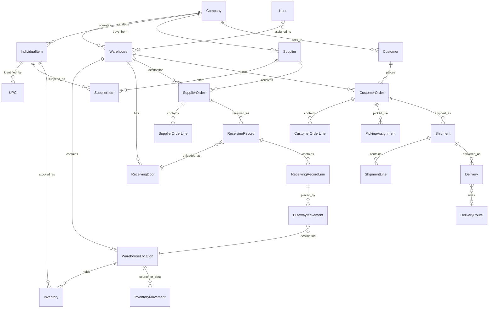

# Warehouse Domain Model

**Status:** Proposed conceptual model for design review\
**Date:** 2026-11-23\
**Source of truth:** Warehouse feature specifications in `features/`\
**Related:** [ADR-0005](./adr/0005-barcode-scanning.md), [ADR-0007](./adr/0007-company-multi-warehouse.md), [ADR-0008](./adr/0008-cross-warehouse-data-isolation.md), [ADR-0009](./adr/0009-inventory-transaction-integrity.md), [ADR-0010](./adr/0010-barcode-error-handling.md)

This document makes the warehouse domain visible for design review. It summarizes **existing** feature specifications and proposed architecture decisions. It is **not** an implemented database schema. Living reference files under `features/reference/` remain empty until features merge to `dev`.

---

## 1. Domain Overview

The Warehouse Management System (WMS) coordinates one company that operates one or more warehouses. Authorized users maintain master data, purchase from suppliers, receive and put away inventory, take customer (store) orders, pick, ship, deliver, and report discrepancies.

Major business areas, as specified:

| Area | Features |
|---|---|
| Company and warehouse administration | 1, 2 |
| Item and inventory | 3, 4 |
| Suppliers and customers | 5, 6 |
| Purchasing and inbound receiving | 7, 9, 10 |
| Putaway | 11 |
| Customer orders | 8, 12 |
| Picking | 13 |
| Shipping and delivery | 14, 15 |
| Exceptions and reporting | 16, 17, 18, 19 |

Barcode scanning, role-based access, warehouse isolation, and transactional inventory updates are cross-cutting concerns (ADRs 0004–0010). Those ADRs remain **Proposed**.

---

## 2. Company and Warehouse Structure

Consistent with [ADR-0007](./adr/0007-company-multi-warehouse.md) and [ADR-0008](./adr/0008-cross-warehouse-data-isolation.md), and with Feature 1 **FR-001**, **FR-010**, Feature 2 **FR-001**, **FR-007**.

| Rule | Existing source |
|---|---|
| At most one company record | Feature 1 **FR-001** |
| One company may operate multiple warehouses | Feature 1 **FR-010**, Feature 2 **FR-001**, ADR-0007 |
| Each warehouse belongs to that company | Feature 2 **FR-007**, **FR-021** |
| Company-level master data is shared (items, suppliers, customers) | ADR-0007; Features 4, 5, 6 |
| Inventory, locations, and operational transactions are warehouse-specific | Feature 3 **FR-004**, **FR-005**; ADR-0007, ADR-0008 |
| Users access warehouse-specific records only when authorized | ADR-0008; README multi-warehouse rules |
| Independent tenant companies are outside the initial proposed scope | ADR-0007; README |

Role-based permissions and warehouse assignments are both required. A valid role does not grant access to every warehouse (ADR-0004, ADR-0008).

---

## 3. Warehouse Physical Structure

Documented in existing specifications:

| Concept | What is specified | Source |
|---|---|---|
| Warehouse | Physical facility; unique ID and code; name, address, phone, active status | Feature 2 **FR-003**–**FR-006** |
| Receiving door | Unload location for a receiving session; must belong to the receiving warehouse; required to complete receiving | Feature 10 **FR-009**–**FR-011**, **FR-045**; Feature 10 states Feature 2 owns Receiving Door definitions |
| Warehouse location / storage location | Scannable bin or slot; belongs to one warehouse; barcode, active status, capacity, restrictions | Feature 3 Warehouse Location entity; Feature 11 Warehouse Location; Feature 13 **A-007** |
| Primary picking location | Preferred eligible bin when sufficient inventory exists | Feature 13 **FR-011**, **A-007**, **A-013** |
| Reserve storage location | Location type distinct from primary picking | Feature 13 **A-007** |
| Location barcodes | Used to verify putaway destinations and pick source bins | Feature 3 **FR-023**; Feature 11; Feature 13 |

**Requires clarification:**

- **Shipping doors** appear in ADR-0007’s organizational sketch. No feature specification defines a Shipping Door entity or maintenance rules.
- **Zones / picking zones** appear in ADR-0007. Feature 13 does not define a Zone entity.
- **Receiving Door and Warehouse Location ownership:** Feature 10 and Feature 11 say Feature 2 owns Receiving Doors (and Feature 11 also says Feature 2 owns Warehouse Locations). Feature 2’s functional requirements maintain warehouse master records only. Feature 3 says Warehouse Location is owned by “Warehouse Location maintenance functionality,” not Feature 2 by name. Location master maintenance is therefore **partially documented**.
- Location capacity measurement is pending between Feature 3 **A-016** and Feature 11.

---

## 4. Core Domain Entities

Proposed conceptual entities supported by existing specs. Field lists are not restated here; see each feature’s Initial Data Model.

| Entity | Purpose | Owning feature | Scope | Principal relationships |
|---|---|---|---|---|
| Company | Single operating organization | 1 | Company | Has many Warehouses |
| Warehouse | Physical facility | 2 | Warehouse (master of a site) | Belongs to Company; has locations, inventory, operational records |
| User | Authenticated employee | Shared auth (not a numbered product feature) | Company, with warehouse assignments | Has Role; assigned to warehouses (ADR-0008) |
| Role | Authorization grouping | Shared auth | Company | Constrains operations (see §5) |
| Individual Item | Product master | 4 | Company | Has UPCs; Supplier Items; inventory balances |
| UPC | Item or case barcode | 4 | Company | Belongs to one Item; `barcodeType` individual or case |
| Supplier | Vendor master | 5 | Company | Has Supplier Items and Supplier Orders |
| Supplier Item | Supplier–item purchasing relationship | 4 | Company | Supplier, Item, purchase price per case |
| Customer | Store/customer master | 6 | Company | Has Customer Orders; optional Delivery Route |
| Warehouse Location | Storage bin/slot | Unclear (see §3) | Warehouse | Belongs to one Warehouse; has Inventory |
| Receiving Door | Unload door | Claimed as Feature 2; not specified in Feature 2 FRs | Warehouse | Belongs to Warehouse; used by Receiving Record |
| Inventory | Quantity of an item at a location | 3 | Warehouse | Item + Warehouse Location; nonnegative units |
| Inventory Count | Physical observation | 3 | Warehouse | Does not auto-change Inventory |
| Inventory Adjustment | Authorized quantity correction | 3 | Warehouse | Changes Inventory with reason/history |
| Inventory Movement | Intra-warehouse location transfer | 3 | Warehouse | Source and destination locations in one warehouse (**A-017**) |
| Supplier Order Form | Purchasing template | 7 | Company | Used by Feature 9 |
| Supplier Order / Line | Purchase order | 9 | Warehouse destination | Supplier, Warehouse, lines with ordered quantities |
| Receiving Record / Line | One receiving session and lines | 10 | Warehouse | Supplier Order, Receiving Door; Quantity Received |
| Receiving Discrepancy | Ordered vs received difference | 10; reported in 17 | Warehouse | Requires manager/supervisor approval to complete session (Feature 10 **FR-032**) |
| Putaway Assignment / Instruction / Movement | Place received units into storage | 11 | Warehouse | From Receiving Record Line to Warehouse Location |
| Customer Order Form | Order template | 8 | Company | Used by Feature 12 |
| Customer Order / Line | Customer demand | 12 | Warehouse fulfillment | Customer, Warehouse; Quantity Ordered / Picked / Shipped / Delivered kept separate |
| Picking Assignment / Instruction / Movement | Fulfill order from bins | 13 | Warehouse | Decreases source Inventory; increases Quantity Picked |
| Picking Shortage | Short pick / replenishment request | 13 | Warehouse | May request replenishment (**FR-037**) |
| Shipment / Shipment Line | Prepared outbound shipment | 14 | Warehouse | From picked quantities; Quantity Shipped |
| Shipment Exception | Shipping exception | 14 | Warehouse | Blocks or records shipping issues |
| Delivery / Delivery Line | Delivery confirmation | 15 | Warehouse / route | Quantity Delivered; does not re-deduct inventory |
| Delivery Route | Route assignment | 6 (customer assignment), 15 (delivery) | Requires clarification of owning feature | Driver assignment (Feature 15 **[NEEDS CLARIFICATION]**) |
| Delivery Discrepancy | Shipped vs delivered difference | 15; reported in 18 | Warehouse | Driver reports; supervisor review for over-delivery |
| Stockout / out-of-stock history | Historical stockout reporting | 16 | Warehouse | Reads Inventory; does not create replenishment orders |
| Inventory Transaction / history | Traceability of inventory-changing operations | 3, 9–15 as applicable; ADR-0009 | Warehouse | User, warehouse, item, quantity, type, timestamp |

No additional entities were added beyond those named in specifications or ADRs that rest on those specifications.

---

## 5. Warehouse Role and Permission Model

Roles **named in existing documents** are not assumed to be the same person unless a spec says so.

### Roles appearing in specifications or the root README

| Role name as written | Where it appears | Typical documented work |
|---|---|---|
| Manager / Warehouse Manager | Features 1–2, 4, 15–19; README | Master data, reports, approvals, discrepancy oversight |
| Administrator | Features 1–5, 7–8 | Create/delete eligible master records |
| Office Clerk | README; ADR-0004 | Master data and orders (README); not always named in feature stories |
| Purchasing Clerk | Features 5, 7, 9 | Supplier master, supplier forms, create supplier orders |
| Customer Service Clerk | Features 6, 8, 12 | Customers, customer forms, customer order entry |
| Inventory Clerk | Feature 3 | Inventory create/view; adjustments if authorized |
| Warehouse Worker | Features 3, 11 (related); README | Counts, movements; README also putaway |
| Put Away Worker | Feature 11 stories | Putaway assignments and confirmations |
| Receiving Clerk / Warehouse Receiver | Features 9–10 | Receiving; Feature 9 also names Warehouse Receiver for PO lookup |
| Receiver | Several “must not modify master data” FRs | Distinct from Receiving Clerk in some tables |
| Picker | Feature 13 | Picking |
| Shipping Clerk | Feature 14; README | Shipping |
| Driver | Feature 15; README | Assigned deliveries only |
| Warehouse Supervisor | Feature 3 | Delete unused inventory; authorize some adjustments |
| Supervisor | Feature 10 **FR-032**, Feature 13 **FR-038**, Feature 15 | Discrepancy/shortage/over-delivery review |
| Shipping Supervisor | Feature 15 data model | Listed among delivery-related roles |

ADR-0004’s five-role table (Manager, Office Clerk, Warehouse Worker, Shipping Clerk, Driver) is a **subset**. Feature specs add Purchasing Clerk, Customer Service Clerk, Inventory Clerk, Put Away Worker, Receiver/Receiving Clerk, Picker, Administrator, and Supervisor variants.

### Driver permissions (do not expand)

Documented **write** work is Feature 15: view assigned deliveries, record Quantity Delivered, report discrepancies / failed attempts. Drivers cannot confirm another driver’s delivery without authorized reassignment (**FR-011**). They cannot silently change finalized deliveries (**FR-051**). They must not modify item master data (Feature 4 **FR-034**). Other features typically deny receiving, picking, shipping, and reporting unless a feature says “if authorized.” Offline delivery recording is **[NEEDS CLARIFICATION]** in Feature 15.

### Permission matrix (documented, not invented)

| Capability | Typical authorized names in specs | Explicitly denied (examples) |
|---|---|---|
| Company / warehouse master | Manager, Administrator | Warehouse workers, receivers, pickers, drivers (F1 **FR-016**, F2 **FR-019**) |
| Item master | Manager, office/inventory clerks as specified in Feature 4 | Workers, receivers, pickers, drivers (**FR-034**) |
| Supplier master | Purchasing Clerk, Manager | Workers, receivers, pickers, drivers (Feature 5 **FR-034**) |
| Customer master | Customer Service Clerk / Manager (Feature 6) | Same warehouse roles must not edit master data |
| Create supplier order | Purchasing Clerk, Manager | Driver without purchasing permission (Feature 9) |
| Receive supplier shipment | Receiving Clerk | Unauthorized Driver (Feature 10) |
| Putaway | Put Away Worker (Feature 11) | README uses Warehouse Worker — names differ |
| Inventory movement | Warehouse Worker (Feature 3 US-3.5) | Driver without movement permission |
| Inventory adjustment | Inventory Clerk / Supervisor if authorized | Driver: no |
| Enter customer order | Customer Service Clerk, Manager | Picker, Driver (Feature 12) |
| Pick | Picker | Driver without picking permission |
| Ship | Shipping Clerk | Driver without shipping permission |
| Deliver | Driver (assigned only) | Other drivers without reassignment |
| Management reports | Warehouse Manager (16–19) | Driver without reporting permission |

Unresolved: whether Office Clerk equals Purchasing Clerk and/or Customer Service Clerk; whether Put Away Worker equals Warehouse Worker; whether Receiver equals Receiving Clerk; Supervisor vs Warehouse Supervisor vs Shipping Supervisor.

---

## 6. Inbound Warehouse Workflow

Existing sequence:

**Supplier Order (Feature 9) → Receiving (Feature 10) → Discrepancy resolution (Feature 10, reported in Feature 17) → Putaway (Feature 11) → Stored / available Inventory (Feature 3).**

| Step | Feature | Inventory effect | Barcode / quantity |
|---|---|---|---|
| Identify replenishment and create PO | 9 | None. Reads inventory and on-order qty | Uses item packaging; does not scan as a warehouse task |
| Identify PO, door, scan receipts | 10 | **Does not** increase stored bin Inventory (Feature 3 Input, **EC-004**; Feature 10) | Individual UPC and Case UPC (**FR-012**–**FR-017**); unknown barcodes rejected (**FR-022**) |
| Compare ordered vs received | 10, 17 | No stored-inventory change | Case units from item packaging vs order line units per case (**FR-016**) |
| Approve unresolved discrepancies | 10 **FR-032** | Manager/Supervisor before session complete | — |
| Putaway assignment and bin verify | 11 | Confirmed Putaway Movement increases stored Inventory at destination; Quantity Received unchanged (Feature 3 **FR-046**) | Item/case UPC and destination bin barcode |
| Available inventory | 3 | Stored quantity at Warehouse Location | Used later by picking |

Received product stays associated with the Receiving Door until putaway (Feature 10 **FR-045**, **A-022**).

---

## 7. Outbound Warehouse Workflow

Existing sequence:

**Customer Order (Feature 12, templates in Feature 8) → Picking (Feature 13) → Shipping (Feature 14) → Delivery (Feature 15) → Discrepancy reporting (Feature 18).**

| Step | Feature | Inventory / quantity effect |
|---|---|---|
| Enter customer order | 12 | No inventory movement. Feature 12 states it does not move inventory between locations |
| Assign pick, scan location and item | 13 | **Stored Inventory decreases at the source location** on successful pick confirmation (**FR-026**, **A-021**, **SC-016**). Quantity Picked increases by the same amount (**FR-027**) |
| Shortage | 13 | Actual Quantity Picked preserved; replenishment **request** possible (**FR-037**); physical replenishment not owned here |
| Ship / record Quantity Shipped | 14 | Quantity Shipped recorded separately from Quantity Picked and Quantity Delivered (**FR-021**). Feature 14 does **not** perform general inventory movement |
| Deliver | 15 | Quantity Delivered updated; Quantity Shipped unchanged (**FR-018**, **FR-055**). ADR-0009: delivery confirmation does not deduct inventory a second time |

**Exact stored-inventory decrease (Feature 13 FR-026):** at **pick confirmation**, source bin Inventory decreases. Shipping and delivery update Quantity Shipped / Quantity Delivered and must not deduct stored Inventory again (Feature 14, Feature 15, ADR-0009). Whether picked units also occupy a staging-location Inventory balance remains **unresolved**.

---

## 8. Barcode Scanning Model

Consistent with [ADR-0005](./adr/0005-barcode-scanning.md) and [ADR-0010](./adr/0010-barcode-error-handling.md); quantity transactions with [ADR-0009](./adr/0009-inventory-transaction-integrity.md).

| Barcode | Identifies | Quantity meaning | Specs |
|---|---|---|---|
| Individual-item UPC | One unit of an item | One unit unless the workflow records another entered quantity | Feature 4; Feature 10 **FR-012**, **FR-017** |
| Case-level barcode | A case of an item | Individual units from validated packaging / units per case | Feature 4 **FR-007**; Feature 10 **FR-013**, **FR-015**, **FR-016** |
| Storage-location barcode | Bin, door, or other location | No item quantity | Feature 3, 10, 11, 13 |

- Backend validates scans before accepting operations (ADR-0005; Feature 10 **FR-022**; Feature 11 item/bin verify APIs; Feature 13 location and item scans).
- Invalid, unknown, mismatched, or unauthorized-location barcodes are rejected without inventory change (ADR-0010; Feature 10 **FR-022**–**FR-024**).
- Duplicate submissions use operation identifiers so the same confirmation is not applied twice (ADR-0010; Feature 3 **FR-068**; Feature 11; Feature 13 **FR-031**).
- Online-first: unconfirmed operations must not display as completed; recover confirmed progress after reconnect (ADR-0010). Full offline inventory sync is out of scope. Driver offline recording remains unresolved (Feature 15).

Scanner hardware models are not specified.

---

## 9. Inventory Model and Transaction Lifecycle

### Stored inventory

- One Inventory balance per Item and Warehouse Location (Feature 3 **FR-002**, **FR-003**, **FR-010**).
- Quantities are individual units (eaches) (Feature 3 **FR-008**).
- Nonnegative unless an authorized business rule says otherwise (Feature 3 **FR-009**; NFR **NFR-DATA-002**).
- Stored Inventory is **separate** from Quantity Ordered, Received, Awaiting Put Away, Picked, Shipped, and Delivered (Feature 3 **FR-029**).

### When stored inventory changes (feature specs)

| Event | Stored Inventory | Other quantities |
|---|---|---|
| Create zero balance | 0, no physical increase | — |
| Receive (Feature 10) | **No** stored-bin increase | Quantity Received |
| Putaway confirm (Feature 11) | Increase destination | Quantity Putaway / awaiting putaway; Quantity Received unchanged |
| Pick confirm (Feature 13) | Decrease source | Quantity Picked increases |
| Ship finalize (Feature 14) | No stored-inventory movement in Feature 14 | Quantity Shipped |
| Deliver finalize (Feature 15) | No second deduction | Quantity Delivered |
| Inventory Movement (Feature 3) | Decrease source, increase destination, same total | Movement history |
| Adjustment (Feature 3) | Set/correct with authorization | Adjustment history |
| Count (Feature 3) | **No** automatic change | Count difference recorded |

Related updates succeed or fail together (Feature 3 **FR-066**–**FR-067**; ADR-0009). History records user, time, and operation. Concurrent updates must not create negatives or double-apply confirmations.

### Remaining clarification (not a new rule)

- **Staging inventory:** Feature 13 decreases source-location Inventory at pick confirmation and does not require a staging-location increase. Whether picked units should also appear as Inventory at a staging or shipping location is **unresolved**.
- **Receiving-door quantity:** Quantity Received is recorded on the Receiving Record. Whether the receiving door also holds an Inventory balance is **unresolved**.

---

## 10. Inventory Movement and Replenishment

| Concept | Supported today? | Source | Gap |
|---|---|---|---|
| Movement within a warehouse | **Yes** — Feature 3 US-3.5, **FR-022**–**FR-070** | Feature 3 owns Inventory Movement | Feature 11 Out of Scope now points to Feature 3. Inter-warehouse transfers remain unresolved |
| Transfers between warehouses | **Not specified** as an ordinary movement | Feature 3 **A-017**; ADR-0007 | Requires a separate authorized workflow; ownership TBD |
| Purchasing replenishment (min/max → PO) | **Partial** | Feature 4 **FR-014**–**FR-015** evaluate; Feature 9 creates Supplier Orders | Warehouse- vs company-level calculation **CL-4.2**; does not auto-create POs (Feature 4 out of scope) |
| Reserve-to-primary-location replenishment | **Request only** | Feature 13 **FR-037**, API request-replenishment | Physical execution **[NEEDS CLARIFICATION]** in Feature 13; Features 14 and 19 exclude pick-face replenishment |
| Replenishment requests | **Partial** | Feature 13 records a request | Duplicate-request rules exist; completing the stock move does not |
| Physical replenishment execution | **Not owned** | Feature 13 out of scope | No dedicated replenishment-execution feature |

**Recommendation (design question, not a new spec):** Do **not** add features in this task. Stakeholders should decide:

1. Treat Feature 3 as the owning **Move Inventory** specification and align Feature 11’s wording; or explicitly split a future movement feature.
2. Either extend Feature 3 (or 11) to **execute** pick-face replenishment after Feature 13 requests, or authorize a future replenishment-execution feature after Feature 13’s clarifications are answered.

Until then, intra-warehouse movement is documented in Feature 3; pick-face replenishment execution is **not** fully documented.

---

## 11. Domain Relationships

The following diagram is a **proposed conceptual domain model**. It is **not** an implemented database schema. `features/reference/data-model.md` currently lists no tables.

Omitted from the diagram: report-only artifacts (Features 16–19), forms (7–8), and entities whose ownership is still unclear (Zone, Shipping Door).

---

## 12. Business Rules and Invariants

| Theme | Rule | Examples |
|---|---|---|
| Unique identifiers | System-generated IDs; business codes unique where specified | Company (F1); Warehouse code (F2 **FR-006**); Item number (F4); Supplier number (F5 **FR-003**); Customer number (F6) |
| Referential integrity | Dependents block unsafe deletes | F1 company with warehouses; F2 warehouse with inventory/history; F5 supplier with orders or supplier items |
| Warehouse isolation | Locations and inventory belong to one warehouse; queries scoped | F3 **FR-004**; F10 receiving door from another warehouse rejected; ADR-0008 |
| Authorized operations | Backend RBAC; UI hiding is insufficient | F1 **FR-015**; ADR-0004 |
| Inventory accuracy | Stored qty separate from order qty; counts do not auto-adjust | F3 **FR-029**, count vs adjustment |
| Barcode validation | Backend validation; distinguish item/case/location | F10 **FR-015**; ADR-0005 |
| Transaction integrity | Related updates atomic; no duplicate confirmations | F3 **FR-066**–**FR-068**; F13 **FR-031**; ADR-0009, ADR-0010 |
| Historical preservation | Inactive masters remain for history; rejected deletes leave data unchanged | F2 **FR-016**; F5 **FR-028**, **FR-031** |
| Inactive masters | Not selected for new operational transactions | F2 **FR-017**; F5 **FR-027**; F6 analogous customer rules |

---

## 13. Feature Ownership and Traceability

| ID | Feature | Owns (writes) | Reads |
|---|---|---|---|
| 1 | Maintain Company | Company | Warehouse existence for delete rules |
| 2 | Maintain Warehouses | Warehouse master | Company; inventory/history existence |
| 3 | Maintain Inventory | Inventory, Count, Adjustment, Inventory Movement | Item, Warehouse, Warehouse Location, receiving/putaway/pick quantities |
| 4 | Maintain Individual Item | Item, UPC, Supplier Item (prices/packaging) | Inventory and on-order qty for replenishment **evaluation** |
| 5 | Maintain Suppliers | Supplier master | Supplier Item, Supplier Order (block delete) |
| 6 | Maintain Customers | Customer master | Orders/deliveries; Delivery Route assignment |
| 7 | Maintain Supplier Order Forms | Supplier order templates | Supplier, Item |
| 8 | Maintain Customer Order Forms | Customer order templates | Customer, Item |
| 9 | Create Supplier Order | Supplier Order and lines | Item, Inventory, Supplier, Warehouse, forms |
| 10 | Receive Supplier Order | Receiving Record/Line, receiving discrepancies | Supplier Order, Item/UPC, Warehouse, Receiving Door |
| 11 | Put Away Received Items | Putaway Assignment, Instruction, Movement | Receiving, Item/UPC, Warehouse Location, Inventory updates via Feature 3 rules |
| 12 | Receive Customer Orders | Customer Order and lines | Customer, Item, forms, inventory availability as specified |
| 13 | Pick Customer Orders | Picking Assignment/Instruction/Movement, shortages | Customer Order, Location, Item/UPC, Inventory |
| 14 | Ship Customer Orders | Shipment, Shipment Line, shipping exceptions | Picked orders, Item/UPC |
| 15 | Deliver Customer Orders | Delivery, Delivery Line, delivery discrepancies | Shipment, Customer, Driver/route |
| 16 | Out of Stock Items | Stockout report/history as specified | Inventory, Warehouse, Item |
| 17 | Supplier Order Shipping Differences | Difference report | Supplier Order, Receiving, discrepancies |
| 18 | Delivery Shipping Differences | Difference report | Shipment, Delivery, discrepancies |
| 19 | Monthly Shipped Item Quantities | Quantity report | Shipment history |

Reporting features (16–19) do not own inbound/outbound execution data.

---

## 14. Open Design Questions

These items are **unresolved**. They are not decided here.

1. **Role naming and permissions.** README/ADR-0004 vs feature-specific names (Purchasing Clerk, Customer Service Clerk, Put Away Worker, Inventory Clerk, Receiver vs Receiving Clerk, multiple Supervisor titles).
2. **Receiving doors and storage-location ownership.** Feature 10/11 say Feature 2 owns Receiving Doors and (in Feature 11) Warehouse Locations. Feature 2 FRs maintain warehouse master records only. Feature 3 names “Warehouse Location maintenance functionality.”
3. **Shipping doors and zones.** Appear in ADR-0007 sketches. No feature specification defines Shipping Door or Zone entities.
4. **Receiving-door inventory representation.** Quantity Received is recorded on the Receiving Record. Whether the receiving door also holds a stored Inventory balance is not specified.
5. **Inter-warehouse transfers.** Feature 3 **A-017**; ADR-0007 says they are not ordinary bin moves. No owning feature.
6. **Physical replenishment execution.** Feature 13 can **request** replenishment; completing a reserve-to-primary stock move has no owning feature. Feature 4/9 cover purchasing replenishment only (**CL-4.2**).
7. **Driver permissions and offline recording.** Feature 15 write scope is assigned delivery confirmation; offline recording is **[NEEDS CLARIFICATION]**. ADR-0010 is online-first.
8. **Delivery-route ownership** between Feature 6 and Feature 15 (**[NEEDS CLARIFICATION]** in Feature 15).
9. **Staging inventory after picking.** Feature 13 decreases the source location. A separate staging-location Inventory balance is not specified.
10. **Location capacity** shared rules (Feature 3 **A-016**, Feature 11 clarifications).
11. **Feature 5 CL-5.1–CL-5.6** (address fields, phone, payment terms, lead-time day type, inactive suppliers on open POs, who may deactivate).

---

## Related diagrams and catalogs

- Feature catalog: [features/README.md](../features/README.md)
- C4 diagrams (system/containers/components, not this domain ERD): [Arch_Diagrams](./Arch_Diagrams/)
- ADRs: [adr/README.md](./adr/README.md)
- Quality attributes: [nfr/quality-attributes.md](./nfr/quality-attributes.md)
