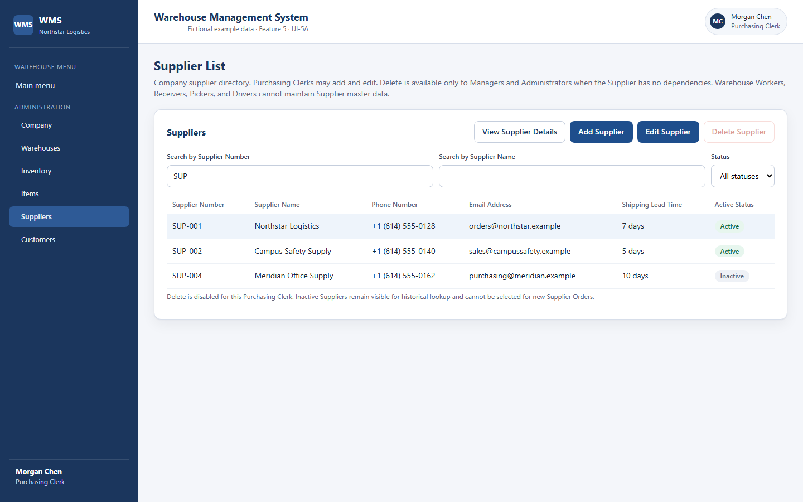
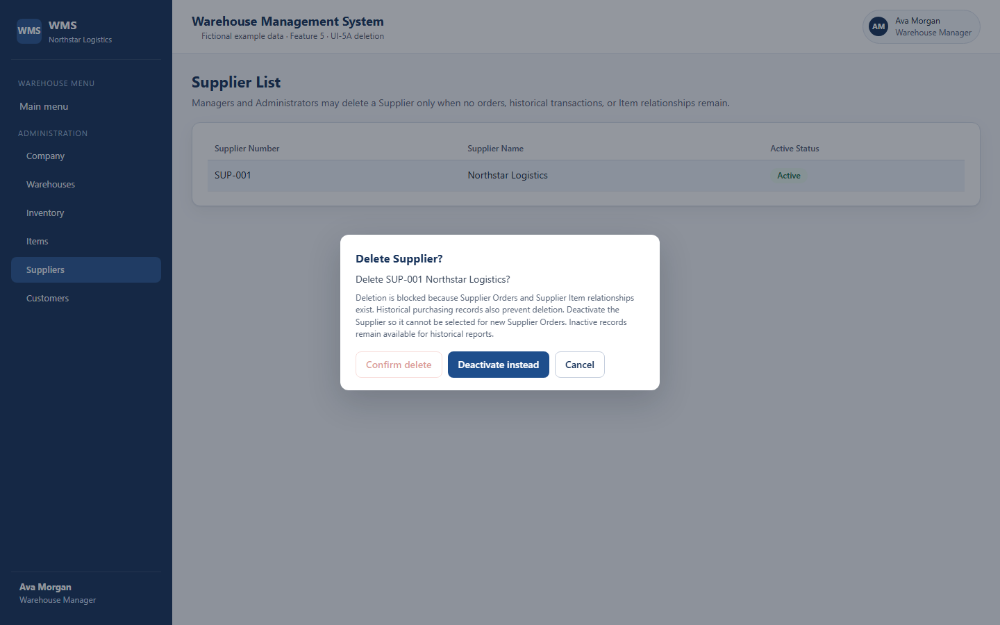
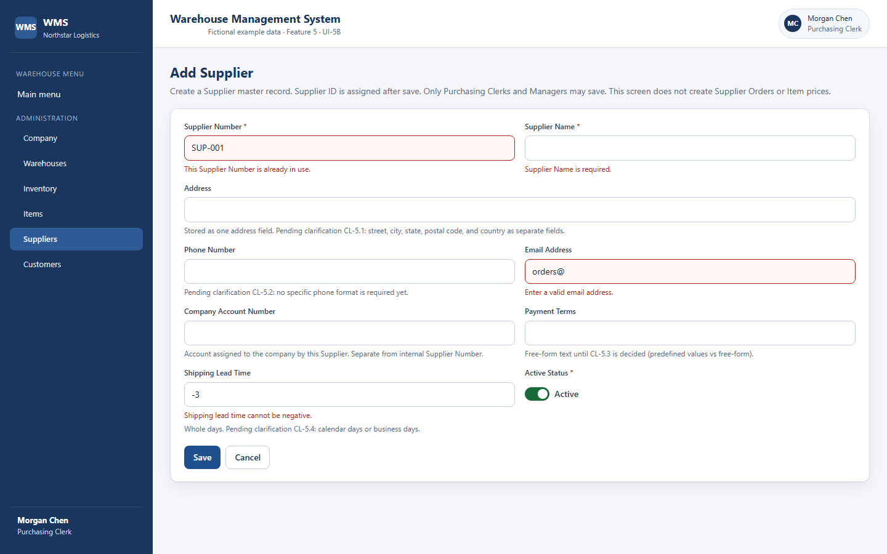
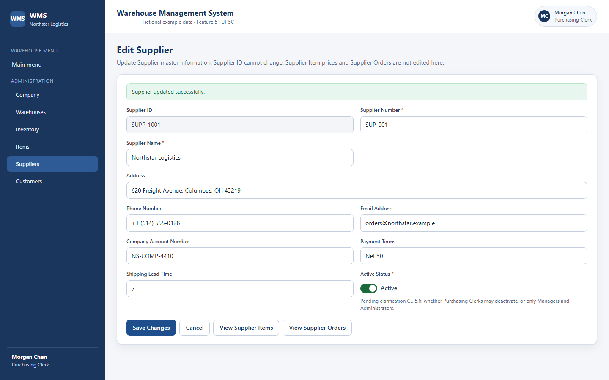
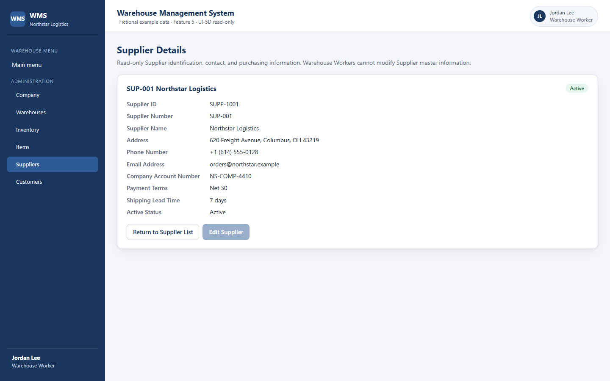
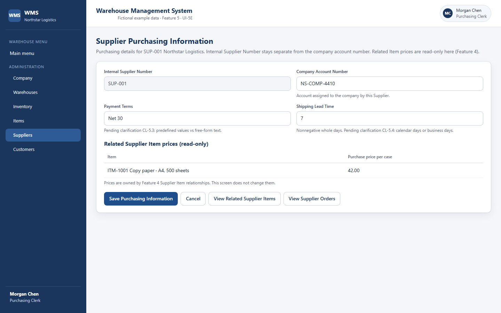
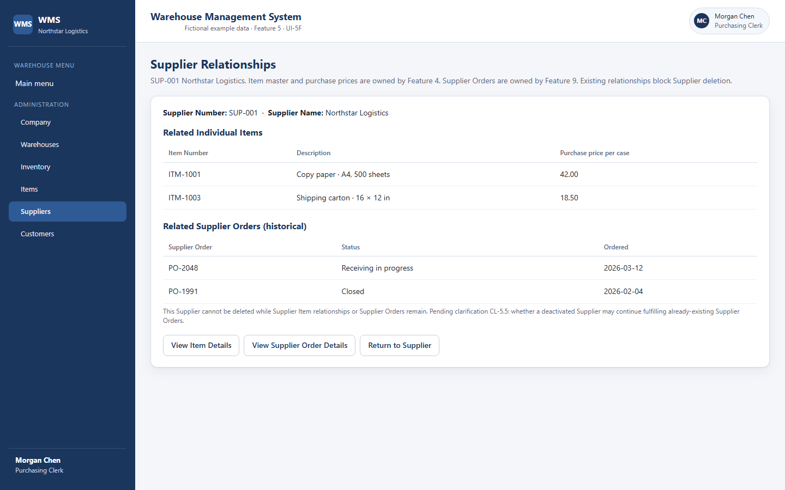

# Feature: Maintain Suppliers

**Feature ID:** 5
**Branch pattern:** `feature/5-maintain-suppliers`
**Status:** Draft - Proposed Rules Pending Approval
**Created:** 2026-09-28
**Input:** The Warehouse Management System maintains information about suppliers from whom the company purchases products. Authorized office personnel can add, edit, delete, or deactivate suppliers. Supplier records include identifying information, contact details, the account number assigned to the company by the supplier, and purchasing information. The system preserves supplier relationships and historical purchase orders.

---

## User Stories

### US-5.1: Add a Supplier

**As a** Purchasing Clerk or Manager
**I want to** add a supplier with its identification and contact information
**So that** the company can purchase products from that supplier.

**Priority:** P1
**Independent test:** Create a supplier with a unique Supplier Number and valid required information, then verify that the record is saved.

### US-5.2: Edit a Supplier

**As a** Purchasing Clerk or Manager
**I want to** update supplier contact information and purchasing details
**So that** the company maintains accurate supplier records.

**Priority:** P1
**Independent test:** Update an existing supplier's address, phone number, or account information and verify that the changes are saved.

### US-5.3: Delete or Deactivate a Supplier

**As a** Manager or Administrator
**I want to** delete an unused supplier or deactivate a supplier that the company no longer purchases from
**So that** obsolete suppliers are not used for new orders while historical purchasing records remain available.

**Priority:** P1
**Independent test:** Verify that an unused supplier can be deleted, while a supplier referenced by purchase orders is protected from deletion and can be deactivated.

### US-5.4: Maintain Supplier Purchasing Information

**As a** Purchasing Clerk or Manager
**I want to** maintain supplier account information, payment terms, and estimated shipping lead time
**So that** purchasing personnel have the information needed to place and manage supplier orders.

**Priority:** P1
**Independent test:** Save and update a supplier's purchasing information and verify that it is available when preparing supplier orders.

---

## Functional Requirements

- **FR-001:** The system MUST allow authorized Purchasing Clerks and Managers to create Supplier records.
- **FR-002:** The system MUST assign a unique, system-generated Supplier ID to each Supplier.
- **FR-003:** The system MUST maintain a unique Supplier Number used internally by the company.
- **FR-004:** The system MUST prevent duplicate Supplier Numbers.
- **FR-005:** The system MUST maintain the Supplier Name.
- **FR-006:** The system MUST maintain the Supplier Address.
- **FR-007:** The system MUST maintain the Supplier Phone Number.
- **FR-008:** The system MUST maintain the Supplier Email Address.
- **FR-009:** The system MUST maintain the account or customer number assigned to the company by the Supplier.
- **FR-010:** The system MUST keep the internal Supplier Number separate from the account number assigned by the Supplier.
- **FR-011:** The system MUST support recording Supplier payment terms.
- **FR-012:** The system MUST support recording estimated Supplier shipping lead time in days.
- **FR-013:** The system MUST require a nonempty Supplier Name and internal Supplier Number.
- **FR-014:** The system MUST validate the format of an Email Address when one is provided.
- **FR-015:** The system MUST reject a negative shipping lead time.
- **FR-016:** The system MUST validate Supplier information before saving.
- **FR-017:** The system MUST reject invalid Supplier information without changing existing records.
- **FR-018:** The system MUST allow authorized Purchasing Clerks and Managers to update existing Supplier information.
- **FR-019:** The system MUST preserve the Supplier ID when Supplier information is updated.
- **FR-020:** The system MUST support searching for a Supplier by Supplier Number or Supplier Name.
- **FR-021:** The system MUST support associating a Supplier with multiple Individual Items.
- **FR-022:** The system MUST support associating an Individual Item with multiple Suppliers.
- **FR-023:** The system MUST maintain Supplier-specific purchasing prices through Supplier Item relationships.
- **FR-024:** The system MUST support associating a Supplier with multiple Supplier Orders.
- **FR-025:** Each Supplier Order MUST reference the Supplier from whom products are ordered.
- **FR-026:** The system MUST support marking a Supplier as active or inactive.
- **FR-027:** The system MUST prevent inactive Suppliers from being selected for new Supplier Orders.
- **FR-028:** The system MUST preserve inactive Supplier records for historical purchasing reports.
- **FR-029:** The system MUST allow authorized Managers and Administrators to delete a Supplier only when no Supplier Orders or other historical transactions reference it and no Supplier Item relationships remain.
- **FR-030:** The system MUST reject deletion when a Supplier is referenced by Supplier Orders, historical transactions, or Supplier Item relationships.
- **FR-031:** The system MUST preserve Supplier information when deletion is rejected.
- **FR-032:** The system MUST reject attempts to edit or delete a Supplier that does not exist.
- **FR-033:** The system MUST restrict Supplier creation and modification to authorized office personnel, including Purchasing Clerks and Managers.
- **FR-034:** Warehouse workers, receivers, pickers, and drivers MUST NOT modify Supplier master information.
- **FR-035:** The system MUST maintain Supplier master information separately from Supplier Orders and Supplier Item purchasing prices.
- **FR-036:** The system MUST preserve relationships between Suppliers, Individual Items, and Supplier Orders.

---

---

## Assumptions

- **A-001:** The company maintains a central Supplier directory used by its purchasing operations.
- **A-002:** Each Supplier receives a unique, system-generated Supplier ID.
- **A-003:** The internal Supplier Number is unique across the company.
- **A-004:** The internal Supplier Number is different from the account number assigned to the company by the Supplier.
- **A-005:** Every Supplier must have a nonempty Supplier Number and Supplier Name.
- **A-006:** Supplier address, phone number, email address, account number, payment terms, and shipping lead time are maintained as part of Supplier master information.
- **A-007:** Supplier email addresses must have a valid format when provided.
- **A-008:** Shipping lead time is measured in whole days and cannot be negative.
- **A-009:** Purchasing Clerks and Managers are authorized to create and update Supplier records.
- **A-010:** Managers and Administrators are authorized to delete Suppliers when no dependencies exist.
- **A-011:** Warehouse Workers, Receivers, Pickers, and Drivers cannot modify Supplier master information.
- **A-012:** Suppliers can be associated with multiple Individual Items through Supplier Item relationships.
- **A-013:** Individual Items may be associated with multiple Suppliers.
- **A-014:** Supplier-specific purchasing prices are maintained through Supplier Item relationships owned by Feature 4.
- **A-015:** Supplier Order records are maintained by Feature 9.
- **A-016:** Every Supplier Order references an existing Supplier.
- **A-017:** Inactive Suppliers cannot be selected for new Supplier Orders.
- **A-018:** Inactive Suppliers remain available for historical purchasing reports.
- **A-019:** Suppliers with existing Supplier Orders, historical transactions, or Supplier Item relationships cannot be deleted.
- **A-020:** The system uses shared authentication and authorization services to enforce User permissions.
- **A-021:** Supplier master maintenance does not directly modify Supplier Orders or Supplier Item purchasing prices.

---

## Edge Cases

- **EC-001:** A User attempts to create a Supplier using an existing Supplier Number.
- **EC-002:** A User attempts to create a Supplier without a Supplier Number.
- **EC-003:** A User attempts to create a Supplier without a Supplier Name.
- **EC-004:** A Supplier Number or Supplier Name contains only whitespace.
- **EC-005:** A User enters an invalid email address.
- **EC-006:** A User leaves an optional email address empty.
- **EC-007:** A User enters a negative shipping lead time.
- **EC-008:** A User attempts to change a Supplier Number to one already assigned to another Supplier.
- **EC-009:** A User attempts to edit a Supplier that does not exist.
- **EC-010:** A User attempts to delete a Supplier that does not exist.
- **EC-011:** A Warehouse Worker attempts to create a Supplier.
- **EC-012:** A Driver attempts to modify Supplier information.
- **EC-013:** A Picker attempts to delete a Supplier.
- **EC-014:** A User attempts to delete a Supplier referenced by Supplier Orders.
- **EC-015:** A User attempts to delete a Supplier with historical purchasing transactions.
- **EC-016:** A User attempts to delete a Supplier with existing Supplier Item relationships.
- **EC-017:** A Manager deactivates a Supplier that has historical purchasing records.
- **EC-018:** A User attempts to select an inactive Supplier for a new Supplier Order.
- **EC-019:** A Supplier has multiple Individual Item relationships.
- **EC-020:** An Individual Item is associated with multiple Suppliers.
- **EC-021:** A Purchasing Clerk updates the company account number assigned by a Supplier.
- **EC-022:** A User mistakenly enters the Supplier's company account number as the internal Supplier Number.
- **EC-023:** A Manager updates Supplier payment terms.
- **EC-024:** A Purchasing Clerk updates estimated shipping lead time.
- **EC-025:** Two authorized Users attempt to create Suppliers with the same Supplier Number simultaneously.
- **EC-026:** A User attempts to delete a Supplier while another transaction is creating a Supplier Order referencing it.
- **EC-027:** A Supplier is deactivated while existing Supplier Orders still reference it.
- **EC-028:** An invalid update must leave all previously stored Supplier information unchanged.

---

## Success Criteria

- **SC-001:** Authorized Purchasing Clerks and Managers can create Suppliers with valid required information.
- **SC-002:** Each Supplier receives a unique, system-generated Supplier ID.
- **SC-003:** Duplicate Supplier Numbers are rejected during creation and update.
- **SC-004:** Supplier Names and internal Supplier Numbers cannot be empty.
- **SC-005:** Invalid email addresses are rejected when provided.
- **SC-006:** Negative shipping lead times are rejected.
- **SC-007:** Authorized Users can update Supplier information without changing the Supplier ID.
- **SC-008:** Suppliers can be searched by Supplier Number or Supplier Name.
- **SC-009:** The internal Supplier Number remains separate from the company account number assigned by the Supplier.
- **SC-010:** Supplier payment terms and estimated shipping lead time can be saved and updated.
- **SC-011:** Suppliers can be associated with multiple Individual Items through Supplier Item relationships.
- **SC-012:** Supplier-specific purchasing prices remain available through Feature 4.
- **SC-013:** Supplier Orders reference the appropriate Supplier.
- **SC-014:** Inactive Suppliers cannot be selected for new Supplier Orders.
- **SC-015:** Inactive Suppliers remain available for historical purchasing reports.
- **SC-016:** Suppliers with historical transactions or Supplier Item relationships cannot be deleted.
- **SC-017:** Authorized Managers and Administrators can delete Suppliers without dependencies.
- **SC-018:** Unauthorized Users cannot create, modify, or delete Supplier master records.
- **SC-019:** Invalid requests do not change previously stored Supplier information.
- **SC-020:** Concurrent requests cannot create duplicate Supplier Numbers.
- **SC-021:** Supplier master maintenance does not directly change Supplier Orders or Supplier Item purchasing prices.
- **SC-022:** All 20 original Gherkin acceptance scenarios pass their corresponding verification tests.
- **SC-023:** The Supplier maintenance screens enforce the same validation and permissions as the backend.

---

## Key Entities

### Supplier

Represents a business from which the company purchases products.

Each Supplier has identifying information, contact details, purchasing information, and an active status.

### Individual Item

Represents a product purchased from Suppliers and sold to Customers.

Individual Item maintenance is defined in Feature 4.

### Supplier Item

Represents the purchasing relationship between a Supplier and an Individual Item.

The relationship stores the price charged by the Supplier for the Item.

### Supplier Order

Represents an order placed by the company with a Supplier.

Supplier Order creation is defined in Feature 9.

### User

Represents an authenticated employee whose role determines whether Supplier information may be maintained.

---

---

## Initial Data Model

### Supplier

| Attribute | Type | Description |
|---|---|---|
| supplierId | Integer | Unique, system-generated identifier; primary key |
| supplierNumber | String | Unique internal Supplier Number |
| name | String | Supplier business name; required |
| address | String | Supplier business address |
| phone | String | Supplier contact telephone number |
| email | String | Supplier contact email address |
| companyAccountNumber | String | Account or customer number assigned to the company by this Supplier |
| paymentTerms | String | Supplier payment terms |
| shippingLeadTimeDays | Integer | Estimated shipping lead time in days |
| isActive | Boolean | Indicates whether the Supplier is active |

**Relationships:**
- One Supplier can supply multiple Individual Items.
- One Supplier can have multiple Supplier Item relationships.
- One Supplier can have multiple Supplier Orders.

**Constraints:**
- supplierId must be unique and cannot be changed.
- supplierNumber must be unique and nonempty.
- name must be nonempty.
- email must have a valid email format when provided.
- shippingLeadTimeDays cannot be negative.
- A Supplier referenced by historical orders cannot be deleted.

### Individual Item

| Attribute | Type | Description |
|---|---|---|
| itemId | Integer | Unique Item identifier |

**Relationships:**
- An Individual Item can be supplied by multiple Suppliers.
- Item information is maintained in Feature 4.

### Supplier Item

| Attribute | Type | Description |
|---|---|---|
| supplierItemId | Integer | Unique Supplier Item relationship identifier |
| supplierId | Integer | Foreign key referencing Supplier |
| itemId | Integer | Foreign key referencing Individual Item |
| purchasePricePerCase | Decimal | Supplier's purchasing price per case |

**Relationships:**
- Each Supplier Item references one Supplier.
- Each Supplier Item references one Individual Item.
- A Supplier can supply multiple Items.
- An Item can be supplied by multiple Suppliers.

**Constraints:**
- The combination of supplierId and itemId must be unique.
- purchasePricePerCase cannot be negative.

### Supplier Order

| Attribute | Type | Description |
|---|---|---|
| supplierOrderId | Integer | Unique Supplier Order identifier |
| supplierId | Integer | Foreign key referencing Supplier |

**Relationships:**
- Each Supplier Order belongs to one Supplier.
- One Supplier can have multiple Supplier Orders.
- Supplier Order details are defined in Feature 9.

### User

| Attribute | Type | Description |
|---|---|---|
| userId | Integer | Unique User identifier |
| role | String | Assigned authorization role |

**Relationships:**
- User roles determine who may create, update, deactivate, or delete Supplier records.

---

---

## Gherkin AC

### US-5.1: Add a Supplier

#### AC-5.1.1: Successfully create Supplier

**Given** the user is authenticated as a Purchasing Clerk or Manager
**When** the user enters a unique Supplier Number, nonempty Supplier Name, and valid Supplier information
**And** saves the record
**Then** the system creates the Supplier
**And** assigns a unique Supplier ID
**And** stores the Supplier information.

#### AC-5.1.2: Reject duplicate Supplier Number

**Given** a Supplier exists with Supplier Number "SUP001"
**And** the user is authorized to maintain Suppliers
**When** the user attempts to create another Supplier with Supplier Number "SUP001"
**Then** the system rejects the request
**And** the existing Supplier remains unchanged.

#### AC-5.1.3: Reject missing Supplier Name

**Given** the user is authorized to maintain Suppliers
**When** the user attempts to create a Supplier with an empty Name
**Then** the system rejects the request
**And** no Supplier record is created.

#### AC-5.1.4: Reject invalid Email Address

**Given** the user is authorized to maintain Suppliers
**When** the user enters an Email Address that does not meet the required email format
**And** attempts to save the Supplier
**Then** the system rejects the request
**And** no Supplier record is created.

#### AC-5.1.5: Reject unauthorized Supplier creation

**Given** the user is authenticated as a Warehouse Worker
**When** the user attempts to create a Supplier
**Then** the system denies the request
**And** no Supplier record is created.

### US-5.2: Edit a Supplier

#### AC-5.2.1: Successfully update Supplier

**Given** a Supplier record exists
**And** the user is authenticated as a Purchasing Clerk
**When** the user updates the Supplier's Address and Phone Number with valid information
**And** saves the changes
**Then** the system stores the updated information
**And** the Supplier ID remains unchanged.

#### AC-5.2.2: Reject invalid Supplier update

**Given** a Supplier record exists
**And** the user is authenticated as a Manager
**When** the user removes the required Supplier Name
**And** attempts to save the changes
**Then** the system rejects the update
**And** the previously stored Supplier information remains unchanged.

#### AC-5.2.3: Reject duplicate Supplier Number during update

**Given** Supplier A has Supplier Number "SUP001"
**And** Supplier B has Supplier Number "SUP002"
**And** the user is authorized to maintain Suppliers
**When** the user changes Supplier B's Number to "SUP001"
**Then** the system rejects the update
**And** both original Supplier Numbers remain unchanged.

#### AC-5.2.4: Reject unauthorized Supplier modification

**Given** a Supplier record exists
**And** the user is authenticated as a Driver
**When** the user attempts to modify Supplier information
**Then** the system denies the request
**And** the Supplier remains unchanged.

#### AC-5.2.5: Reject editing nonexistent Supplier

**Given** no Supplier exists with the requested Supplier ID
**And** the user is authenticated as a Manager
**When** the user attempts to update that Supplier
**Then** the system rejects the request
**And** no Supplier record is changed.

### US-5.3: Delete or Deactivate a Supplier

#### AC-5.3.1: Successfully delete unused Supplier

**Given** a Supplier exists
**And** no Supplier Orders or historical transactions reference it
**And** no Supplier Item relationships remain
**And** the user is authenticated as an Administrator
**When** the user requests Supplier deletion
**Then** the system deletes the Supplier record
**And** the Supplier is no longer available in the Supplier directory.

#### AC-5.3.2: Prevent deletion when Supplier Orders exist

**Given** a Supplier is referenced by one or more Supplier Orders
**And** the user is authenticated as a Manager
**When** the user requests Supplier deletion
**Then** the system rejects the deletion
**And** the Supplier and its order history remain unchanged.

#### AC-5.3.3: Prevent deletion when Supplier Item relationships exist

**Given** a Supplier is associated with one or more Individual Items
**And** the user is authenticated as an Administrator
**When** the user requests Supplier deletion
**Then** the system rejects the deletion
**And** the Supplier Item relationships remain unchanged.

#### AC-5.3.4: Deactivate Supplier

**Given** an active Supplier exists
**And** the user is authenticated as a Manager
**When** the user marks the Supplier as inactive
**Then** the system saves the inactive status
**And** the Supplier remains available for historical reporting
**And** the Supplier cannot be selected for new Supplier Orders.

#### AC-5.3.5: Reject unauthorized Supplier deletion

**Given** a Supplier record exists
**And** the user is authenticated as a Picker
**When** the user attempts to delete the Supplier
**Then** the system denies the request
**And** the Supplier remains unchanged.

#### AC-5.3.6: Reject deletion of nonexistent Supplier

**Given** no Supplier exists with the requested Supplier ID
**And** the user is authenticated as an Administrator
**When** the user requests deletion of that Supplier
**Then** the system rejects the request
**And** no Supplier record is changed.

### US-5.4: Maintain Supplier Purchasing Information

#### AC-5.4.1: Save Supplier Account Number

**Given** an existing Supplier record
**And** the user is authenticated as a Purchasing Clerk
**When** the user enters the Account Number assigned to the company by the Supplier
**And** saves the changes
**Then** the system stores the Account Number
**And** keeps it separate from the internal Supplier Number.

#### AC-5.4.2: Update Supplier Payment Terms

**Given** an existing Supplier record
**And** the user is authenticated as a Manager
**When** the user changes the Supplier's Payment Terms
**And** saves the changes
**Then** the system stores the updated Payment Terms.

#### AC-5.4.3: Save Supplier Shipping Lead Time

**Given** an existing Supplier record
**And** the user is authenticated as a Purchasing Clerk
**When** the user enters a shipping lead time of 7 days
**And** saves the changes
**Then** the system stores the shipping lead time as 7 days.

#### AC-5.4.4: Reject negative Shipping Lead Time

**Given** an existing Supplier record
**And** the user is authenticated as a Manager
**When** the user attempts to set the shipping lead time to -3 days
**Then** the system rejects the update
**And** the previously stored shipping lead time remains unchanged.

---

## Data Ownership

### Supplier Master Data

**Owner:** Feature 5 — Maintain Suppliers.

Feature 5 owns Supplier master records, including:
- Supplier ID.
- Internal Supplier Number.
- Supplier Name.
- Address.
- Phone Number.
- Email Address.
- Company Account Number assigned by the Supplier.
- Payment Terms.
- Estimated Shipping Lead Time.
- Active or Inactive Status.

Feature 5 is responsible for creating, updating, deactivating, and deleting eligible Supplier records.

Other features may read Supplier master information but must not directly modify it.

### Individual Item Data

**Owner:** Feature 4 — Maintain Individual Item.

Feature 4 owns Individual Item master information.

Feature 5 may reference existing Items but must not create, update, or delete Item master records.

### Supplier Item Relationships

**Owner:** Feature 4 — Maintain Individual Item.

Supplier Item relationships associate Suppliers with Individual Items and maintain supplier-specific purchasing prices.

Feature 5 references these relationships when displaying Supplier purchasing information and determining whether a Supplier can be deleted.

Feature 5 must not directly change Supplier Item purchasing prices.

### Supplier Order Data

**Owner:** Feature 9 — Create Supplier Order.

Feature 9 owns Supplier Order records and their relationships with Suppliers.

Feature 5 provides Supplier information to the Supplier Order workflow.

Feature 5 must not directly modify Supplier Order transactions.

### User and Authorization Data

**Owner:** Shared authentication and authorization functionality.

Feature 5 uses User roles to enforce Supplier maintenance permissions.

**Purchasing Clerks and Managers:**
- Create Supplier records.
- Edit Supplier information.
- Maintain Supplier purchasing details.

**Managers and Administrators:**
- Delete eligible Suppliers.

**Warehouse Workers, Receivers, Pickers, and Drivers:**
- Cannot modify Supplier master information.

### Data Consistency Rules

- Every Supplier must have a unique Supplier ID.
- Every internal Supplier Number must be unique.
- Supplier ID must not change during updates.
- The internal Supplier Number and company account number must be stored separately.
- Supplier Item relationships must reference existing Suppliers.
- Supplier Orders must reference existing Suppliers.
- Inactive Suppliers must remain available for historical reporting.
- Inactive Suppliers must not be selected for new Supplier Orders.
- Suppliers with historical transactions or Supplier Item relationships must not be deleted.
- Concurrent requests must not bypass Supplier Number uniqueness or deletion dependency checks.

---

---

## API Requirements

**Design status:** Proposed API contracts for Feature 5.

The following endpoints and response codes are design proposals and must follow the Warehouse project's established API conventions.

**Base resource:** `/api/suppliers`

### API-5.1: List and Search Suppliers

**Method:** GET
**Endpoint:** `/api/suppliers`

**Purpose:** Retrieve Supplier records.

**Authorization:** Authenticated Users with Supplier viewing permission.

**Query parameters:**
- `supplierNumber`
- `name`
- `isActive`

**Successful response:** `200 OK`

**Example response:**

    [
      {
        "supplierId": 101,
        "supplierNumber": "SUP001",
        "name": "ABC Distribution",
        "address": "100 Main Street",
        "phone": "555-0100",
        "email": "orders@example.com",
        "companyAccountNumber": "ACCT1001",
        "paymentTerms": "Net 30",
        "shippingLeadTimeDays": 7,
        "isActive": true
      }
    ]

**Rules:**
- Search by Supplier Number or Supplier Name.
- Allow authorized viewing of inactive Suppliers.
- Do not modify Supplier records during search.

**Traceability:** FR-020, FR-026, FR-028.

### API-5.2: Create Supplier

**Method:** POST
**Endpoint:** `/api/suppliers`

**Purpose:** Create a Supplier record.

**Authorization:** Purchasing Clerk or Manager.

**Example request:**

    {
      "supplierNumber": "SUP001",
      "name": "ABC Distribution",
      "address": "100 Main Street",
      "phone": "555-0100",
      "email": "orders@example.com",
      "companyAccountNumber": "ACCT1001",
      "paymentTerms": "Net 30",
      "shippingLeadTimeDays": 7,
      "isActive": true
    }

**Successful response:** `201 Created`

**Validation:**
- Supplier Number is required and unique.
- Supplier Name is required.
- Email format must be valid when provided.
- Shipping lead time cannot be negative.
- Supplier ID is generated automatically.
- Internal Supplier Number and company account number remain separate.
- Unauthorized requests are rejected.

**Error responses:**
- `400 Bad Request` for invalid data.
- `401 Unauthorized` for missing authentication.
- `403 Forbidden` for insufficient permissions.
- `409 Conflict` for duplicate Supplier Numbers.

**Traceability:** US-5.1; FR-001 through FR-017, FR-033, FR-034; AC-5.1.1 through AC-5.1.5.

### API-5.3: Get Supplier Details

**Method:** GET
**Endpoint:** `/api/suppliers/{supplierId}`

**Purpose:** Retrieve an existing Supplier.

**Authorization:** Authenticated Users with Supplier viewing permission.

**Successful response:** `200 OK`

**Displayed information:**
- Supplier ID.
- Supplier Number.
- Supplier Name.
- Address.
- Phone Number.
- Email Address.
- Company Account Number.
- Payment Terms.
- Shipping Lead Time.
- Active Status.

**Error responses:**
- `401 Unauthorized`.
- `403 Forbidden`.
- `404 Not Found`.

**Traceability:** FR-005 through FR-012, FR-020, FR-026.

### API-5.4: Update Supplier

**Method:** PUT
**Endpoint:** `/api/suppliers/{supplierId}`

**Purpose:** Update Supplier master information.

**Authorization:** Purchasing Clerk or Manager.

**Example request:**

    {
      "supplierNumber": "SUP001",
      "name": "ABC Distribution",
      "address": "200 Main Street",
      "phone": "555-0199",
      "email": "purchasing@example.com",
      "companyAccountNumber": "ACCT1001",
      "paymentTerms": "Net 45",
      "shippingLeadTimeDays": 5,
      "isActive": true
    }

**Successful response:** `200 OK`

**Validation:**
- Supplier must exist.
- Supplier ID remains unchanged.
- Supplier Number remains unique.
- Required fields cannot be empty.
- Email must have a valid format when provided.
- Shipping lead time cannot be negative.
- Invalid updates must not change existing information.

**Error responses:**
- `400 Bad Request`.
- `401 Unauthorized`.
- `403 Forbidden`.
- `404 Not Found`.
- `409 Conflict` for duplicate Supplier Numbers.

**Traceability:** US-5.2, US-5.4; FR-013 through FR-019, FR-032 through FR-034; AC-5.2.1 through AC-5.2.5, AC-5.4.1 through AC-5.4.4.

### API-5.5: Deactivate or Reactivate Supplier

**Method:** PATCH
**Endpoint:** `/api/suppliers/{supplierId}/status`

**Purpose:** Change Supplier active status.

**Authorization:** Manager or Administrator, subject to approved status-change permissions.

**Example request:**

    {
      "isActive": false
    }

**Successful response:** `200 OK`

**Rules:**
- Supplier must exist.
- Inactive Suppliers cannot be selected for new Supplier Orders.
- Existing Supplier Orders remain unchanged.
- Historical purchasing information remains available.

**Error responses:**
- `400 Bad Request`.
- `401 Unauthorized`.
- `403 Forbidden`.
- `404 Not Found`.

**Traceability:** US-5.3; FR-026 through FR-028; AC-5.3.4.

### API-5.6: Delete Supplier

**Method:** DELETE
**Endpoint:** `/api/suppliers/{supplierId}`

**Purpose:** Delete an unused Supplier.

**Authorization:** Manager or Administrator.

**Successful response:** `204 No Content`

**Validation:**
- Supplier must exist.
- No Supplier Orders may reference the Supplier.
- No historical transactions may reference the Supplier.
- No Supplier Item relationships may remain.
- Dependency checks must remain valid throughout the deletion transaction.
- Rejected deletion must preserve Supplier information.

**Error responses:**
- `401 Unauthorized`.
- `403 Forbidden`.
- `404 Not Found`.
- `409 Conflict` when dependencies prevent deletion.

**Traceability:** US-5.3; FR-029 through FR-032; AC-5.3.1 through AC-5.3.3, AC-5.3.5, AC-5.3.6.

### API-5.7: View Supplier Item Relationships

**Method:** GET
**Endpoint:** `/api/suppliers/{supplierId}/items`

**Purpose:** Display Individual Items associated with a Supplier.

**Authorization:** Authenticated Users with appropriate purchasing information permissions.

**Successful response:** `200 OK`

**Example response:**

    [
      {
        "supplierItemId": 301,
        "supplierId": 101,
        "itemId": 201,
        "purchasePricePerCase": 18.00
      }
    ]

**Rules:**
- Retrieve Supplier Item relationships maintained by Feature 4.
- Do not directly modify Item master information.
- Do not directly modify Supplier Item purchasing prices.
- Return only information permitted for the User's role.

**Traceability:** FR-021 through FR-023, FR-036.

### API-5.8: View Supplier Orders

**Method:** GET
**Endpoint:** `/api/suppliers/{supplierId}/orders`

**Purpose:** Retrieve Supplier Orders associated with a Supplier.

**Authorization:** Authorized purchasing personnel.

**Successful response:** `200 OK`

**Rules:**
- Supplier Orders are owned by Feature 9.
- Display the Supplier's related orders without modifying them.
- Preserve historical order relationships.
- Supplier deletion must be blocked when related orders exist.

**Traceability:** FR-024, FR-025, FR-028 through FR-030.

### Shared API Rules

- Backend authentication and authorization are required.
- Supplier IDs must be system-generated.
- Supplier Numbers must be unique.
- Invalid data must be rejected without partial updates.
- Email format validation must be enforced.
- Negative shipping lead times must be rejected.
- Inactive Suppliers must not be available for new Supplier Orders.
- Historical Supplier relationships must be preserved.
- Deletion must enforce referential integrity.
- Concurrent operations must respect uniqueness and dependency constraints.
- API contracts must follow the project's existing backend conventions.

---

---

## Screen Requirements
### UI Design

**Design status:** Mockups for Feature 5 Screen IDs UI-5A through UI-5F. These are design images, not implemented application screens.

### Screen UI-5A: Supplier List

**Design files:** `docs/ui/supplier-list.png`, `docs/ui/supplier-list-delete.png`

**Purpose:** Search and select Supplier records.

**Displayed information:**
- Supplier Number.
- Supplier Name.
- Phone Number.
- Email Address.
- Shipping Lead Time.
- Active Status.

**Actions:**
- Search by Supplier Number.
- Search by Supplier Name.
- Filter active and inactive Suppliers.
- View Supplier Details.
- Add Supplier, if authorized.
- Edit Supplier, if authorized.
- Delete Supplier, if authorized.

**Rules:**
- Only authorized Users can perform maintenance actions.
- Inactive Suppliers must be distinguishable from active Suppliers.
- Backend permissions must be enforced.

### Screen UI-5B: Add Supplier

**Design file:** `docs/ui/supplier-add.png`

**Purpose:** Create a new Supplier.

**Fields:**

| Field | Control | Required |
|---|---|---|
| Supplier Number | Text input | Yes |
| Supplier Name | Text input | Yes |
| Address | Text input | No |
| Phone Number | Text input | No |
| Email Address | Text input | No |
| Company Account Number | Text input | No |
| Payment Terms | Text input | No |
| Shipping Lead Time | Integer input | No |
| Active Status | Checkbox or selection | Yes |

**Actions:**
- Save.
- Cancel.

**Rules:**
- Supplier Number must be unique.
- Supplier Number and Supplier Name cannot be empty.
- Email must be valid when provided.
- Shipping Lead Time cannot be negative.
- Supplier ID is generated automatically.
- Only authorized Purchasing Clerks and Managers may save.

### Screen UI-5C: Edit Supplier

**Design file:** `docs/ui/supplier-edit.png`

**Purpose:** Modify Supplier information.

**Fields:**
- Supplier ID (read-only).
- Supplier Number.
- Supplier Name.
- Address.
- Phone Number.
- Email Address.
- Company Account Number.
- Payment Terms.
- Shipping Lead Time.
- Active Status.

**Actions:**
- Save Changes.
- Cancel.
- View Supplier Items.
- View Supplier Orders.

**Rules:**
- Supplier ID must remain unchanged.
- Supplier Number must remain unique.
- Invalid updates must not overwrite existing information.
- Supplier Item prices must not be modified through Supplier master maintenance.
- Supplier Orders must not be modified through this screen.

### Screen UI-5D: Supplier Details

**Design file:** `docs/ui/supplier-details.png`

**Purpose:** Display Supplier identification, contact, and purchasing information.

**Displayed information:**
- Supplier ID.
- Supplier Number.
- Supplier Name.
- Address.
- Phone Number.
- Email Address.
- Company Account Number.
- Payment Terms.
- Shipping Lead Time.
- Active Status.

**Rules:**
- Users may view only information allowed by their permissions.
- Unauthorized Users cannot modify Supplier master information.
- Historical Supplier records remain accessible to authorized Users.

### Screen UI-5E: Supplier Purchasing Information

**Design file:** `docs/ui/supplier-purchasing.png`

**Purpose:** Display and maintain Supplier purchasing details.

**Fields:**
- Company Account Number.
- Payment Terms.
- Shipping Lead Time.

**Actions:**
- Save Purchasing Information.
- Cancel.
- View Related Supplier Items.
- View Supplier Orders.

**Rules:**
- Internal Supplier Number and company account number must remain separate.
- Shipping Lead Time must be nonnegative.
- Purchasing information may be modified only by authorized Purchasing Clerks and Managers.
- Related Supplier Item prices are read-only in this screen.

### Screen UI-5F: Supplier Relationships

**Design file:** `docs/ui/supplier-relationships.png`

**Purpose:** Display Supplier Item relationships and Supplier Order references.

**Displayed information:**
- Supplier Number.
- Supplier Name.
- Related Individual Items.
- Supplier-specific purchasing prices, when permitted.
- Related Supplier Orders.

**Actions:**
- View Item Details.
- View Supplier Order Details.
- Return to Supplier.

**Rules:**
- Individual Item master data remains owned by Feature 4.
- Supplier Item purchasing prices remain owned by Feature 4.
- Supplier Orders remain owned by Feature 9.
- Existing relationships must be considered when determining whether a Supplier can be deleted.

### Proposed Role Permissions

| Role | View Suppliers | Add Suppliers | Edit Suppliers | Purchasing Information | Delete Suppliers |
|---|---|---|---|---|---|
| Purchasing Clerk | Yes | Yes | Yes | Maintain | No |
| Manager | Yes | Yes | Yes | Maintain | Yes, if eligible |
| Administrator | According to permissions | According to permissions | According to permissions | According to permissions | Yes, if eligible |
| Warehouse Worker | If authorized | No | No | No editing | No |
| Receiver | If authorized | No | No | No editing | No |
| Picker | If authorized | No | No | No editing | No |
| Driver | If authorized | No | No | No editing | No |

### Validation and Feedback

The UI must provide clear messages for:
- Duplicate Supplier Number.
- Missing Supplier Number.
- Missing Supplier Name.
- Invalid Email Address.
- Negative Shipping Lead Time.
- Supplier not found.
- Unauthorized Supplier maintenance.
- Supplier deletion blocked by Supplier Orders.
- Supplier deletion blocked by historical transactions.
- Supplier deletion blocked by Supplier Item relationships.
- Successful Supplier creation.
- Successful Supplier update.
- Successful Supplier deactivation.
- Successful Supplier deletion.

### UI Design Deliverables

These screen images are stored and linked above:

- `docs/ui/supplier-list.png`
- `docs/ui/supplier-list-delete.png`
- `docs/ui/supplier-add.png`
- `docs/ui/supplier-edit.png`
- `docs/ui/supplier-details.png`
- `docs/ui/supplier-purchasing.png`
- `docs/ui/supplier-relationships.png`

---

---

## Definition of Done

### Requirements and Design

- [ ] All four User Stories are documented.
- [ ] All thirty-six original Functional Requirements are retained.
- [ ] Assumptions are documented.
- [ ] Edge Cases are documented.
- [ ] Success Criteria are documented.
- [ ] Key Entities are documented.
- [ ] Initial Data Model is documented.
- [ ] All twenty original Gherkin acceptance scenarios are retained.
- [ ] Data Ownership is documented.
- [ ] API Requirements are documented.
- [ ] Screen Requirements are documented.
- [ ] Out-of-Scope functionality is identified.
- [ ] Pending clarifications are reviewed.

### Supplier Management

- [ ] Authorized Purchasing Clerks and Managers can create Suppliers.
- [ ] Each Supplier receives a unique, system-generated Supplier ID.
- [ ] Supplier Numbers are unique.
- [ ] Required Supplier information is validated.
- [ ] Invalid Email Addresses are rejected.
- [ ] Negative Shipping Lead Times are rejected.
- [ ] Authorized Users can update Supplier information.
- [ ] Supplier updates preserve the original Supplier ID.
- [ ] Invalid updates leave existing Supplier information unchanged.
- [ ] Suppliers can be searched by Supplier Number or Supplier Name.

### Purchasing Information

- [ ] Internal Supplier Numbers are separate from company account numbers.
- [ ] Company Account Numbers can be saved and updated.
- [ ] Supplier Payment Terms can be saved and updated.
- [ ] Shipping Lead Time can be saved and updated.
- [ ] Supplier purchasing information is available to authorized purchasing personnel.

### Supplier Relationships

- [ ] A Supplier can be associated with multiple Individual Items.
- [ ] An Individual Item can be associated with multiple Suppliers.
- [ ] Supplier-specific purchasing prices are available through Supplier Item relationships.
- [ ] Supplier Item relationships remain owned by Feature 4.
- [ ] Supplier Orders reference existing Suppliers.
- [ ] Supplier Orders remain owned by Feature 9.

### Supplier Status and Deletion

- [ ] Authorized Users can deactivate Suppliers.
- [ ] Inactive Suppliers cannot be selected for new Supplier Orders.
- [ ] Inactive Suppliers remain available for historical reporting.
- [ ] Suppliers with Supplier Orders cannot be deleted.
- [ ] Suppliers with historical transactions cannot be deleted.
- [ ] Suppliers with Supplier Item relationships cannot be deleted.
- [ ] Authorized Managers and Administrators can delete eligible unused Suppliers.
- [ ] Unauthorized deletion attempts are rejected.
- [ ] Rejected deletion preserves Supplier information.

### Authorization and Security

- [ ] Purchasing Clerks and Managers can maintain Supplier information.
- [ ] Warehouse Workers cannot modify Supplier master information.
- [ ] Receivers cannot modify Supplier master information.
- [ ] Pickers cannot modify Supplier master information.
- [ ] Drivers cannot modify Supplier master information.
- [ ] Backend permissions are enforced independently of UI controls.
- [ ] Concurrent requests cannot create duplicate Supplier Numbers.
- [ ] Concurrent transactions cannot bypass deletion dependency checks.

### Acceptance Testing

- [ ] AC-5.1.1 through AC-5.1.5 pass.
- [ ] AC-5.2.1 through AC-5.2.5 pass.
- [ ] AC-5.3.1 through AC-5.3.6 pass.
- [ ] AC-5.4.1 through AC-5.4.4 pass.
- [ ] Tests cover duplicate Supplier Numbers.
- [ ] Tests cover required field validation.
- [ ] Tests cover Email Address validation.
- [ ] Tests cover Shipping Lead Time validation.
- [ ] Tests cover unauthorized operations.
- [ ] Tests cover inactive Supplier restrictions.
- [ ] Tests cover deletion with historical dependencies.
- [ ] Tests cover Supplier Item relationship dependencies.

### Documentation and Review

- [ ] Feature 5 follows the required OC Speckit section structure.
- [ ] Relevant architecture decisions are documented in `docs/adr/`.
- [ ] Relevant non-functional requirements are addressed in `docs/nfr/`.
- [ ] Supplier relationships are represented in the relevant C4 diagrams.
- [ ] Supplier List screen image is created.
- [ ] Add Supplier screen image is created.
- [ ] Edit Supplier screen image is created.
- [ ] Supplier Details screen image is created.
- [ ] Supplier Purchasing Information screen image is created.
- [ ] Supplier Relationships screen image is created.
- [ ] Screen images are linked to Feature 5.
- [ ] Changes are committed to the `design-draft` branch.
- [ ] Changes are pushed to GitHub.

**Draft note:** These checkboxes represent completion requirements. They do not indicate that implementation, tests, or UI images have already been completed.

---

## Out of Scope

Feature 5 does not include:

- Creating or maintaining Company records.
- Creating or maintaining Warehouse records.
- Creating or maintaining Individual Item master records.
- Creating or modifying Supplier Item purchasing prices.
- Creating or processing Supplier Orders.
- Receiving products from Suppliers.
- Maintaining Inventory quantities.
- Performing Put Away, Picking, or Shipping.
- Creating or processing Customer Orders.
- Maintaining User accounts, passwords, or authorization roles.
- Automatically placing orders with Suppliers.
- Performing Supplier payments or accounting transactions.
- Managing Supplier invoices.
- Calculating advanced Supplier performance metrics.
- Deleting Suppliers with existing Supplier Orders, historical transactions, or Supplier Item relationships.
- Removing historical Supplier information when a Supplier is deactivated.
- Allowing Warehouse Workers, Receivers, Pickers, or Drivers to modify Supplier master information.

### Pending Clarifications

- **CL-5.1:** Confirm whether Supplier address information requires separate Street, City, State, Postal Code, and Country fields.
- **CL-5.2:** Confirm whether Supplier Phone Number validation requires a specific format.
- **CL-5.3:** Confirm whether Supplier payment terms should use predefined values or free-form text.
- **CL-5.4:** Confirm whether estimated shipping lead time represents calendar days or business days.
- **CL-5.5:** Confirm whether deactivated Suppliers may continue fulfilling already-existing Supplier Orders.
- **CL-5.6:** Confirm whether Purchasing Clerks may deactivate Suppliers or whether status changes are restricted to Managers and Administrators.

These decisions should be coordinated with Feature 4 and Feature 9 before implementation.
